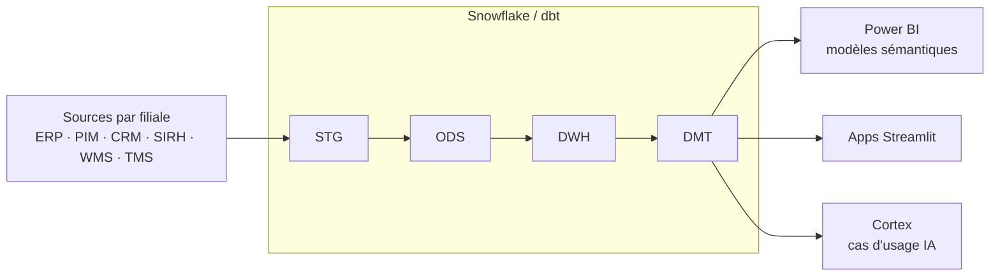

# Enrico RILCY — Data & AI Delivery Architect

**Senior Data & AI Project / Platform Manager** · 11+ ans en Data, BI et pilotage de projets · Nantes / Paris

[LinkedIn](https://www.linkedin.com/in/A-COMPLETER) · [Email](mailto:A-COMPLETER) · [CLIENTSO](https://www.clientso.fr)

---

## En bref

Je conçois des plateformes data et je les amène jusqu'en production, puis jusqu'à l'usage réel par les métiers. Mon terrain : le point de rencontre entre l'architecture (modélisation, pipelines, performance, coûts) et la livraison (cadrage, équipes, parties prenantes, adoption).

- **Aujourd'hui** : je pilote les initiatives Data & IA de Bunzl France sur cinq filiales.
- **En parallèle** : j'édite mes propres produits SaaS sous la marque DataPlace, de la spécification au déploiement.
- **Sur scène** : speaker au Snowflake World Tour Paris (octobre 2026) sur la plateforme data de Bunzl.

## Ce que j'apporte

| Axe | Concrètement |
|---|---|
| **Architecture de plateforme** | Refonte complète d'une plateforme BI en couches (STG → ODS → DWH → DMT), modèles sémantiques, data marts, lakehouses |
| **Delivery** | Cadrage, priorisation, livraison incrémentale ; pilotage de data engineers avec ou sans lien hiérarchique |
| **FinOps** | Suivi de la consommation et du budget de capacité, reporting hebdomadaire et mensuel aux parties prenantes |
| **IA appliquée** | Outils IA livrés aux métiers, phase d'accélération avec Snowflake Cortex |
| **Transmission** | Transferts de connaissances, formation des équipes, prise de parole en conférence |

---

## Réalisations sélectionnées

### 1. Refonte de la plateforme BI — Bunzl France

**Contexte.** Cinq filiales, chacune avec son propre ERP et plusieurs sources de données (ERP, PIM, CRM, SIRH, WMS, TMS…), et un besoin de pilotage unifié.

**Ce que j'ai fait.**
- Conduit la refonte complète de la plateforme BI sur Snowflake, dbt et Power BI.
- Structuré l'alimentation en quatre couches dbt (STG → ODS → DWH → DMT) à partir des systèmes sources de chaque filiale.
- Piloté les data engineers pour livrer data marts, modèles sémantiques et outils IA.
- Organisé le transfert de connaissances sur la chaîne d'alimentation.

**Résultat.** Une plateforme unique utilisée par plus de 1 000 utilisateurs.

### 2. Outils d'exploitation et d'observabilité — Streamlit in Snowflake

**Problème.** Avant la migration vers la nouvelle plateforme data dbt / Snowflake / Power BI, la BI était disponible de façon non consolidée dans des outils divers : chaque filiale avait son outil décisionnel (Cognos, QlikView…). Les métiers constataient souvent des écarts de montants d'un jour à l'autre sans pouvoir les expliquer ; l'équipe data n'avait ni vue consolidée sur la santé des flux, ni possibilité de time travel.

**Ce que j'ai construit.**
- **Télémétrie de valeurs** : mesure et justification des évolutions de montants entre J et J-1.
- **Monitoring des flux** de données.
- **EPM** : outil de pilotage de la performance.

**Résultat.** Des heures d'investigation évitées. Une refonte de l'ingestion des données, avec une phase de validation poussée des règles de gestion et des résultats. Conséquence : moins de tickets de support et plus de confiance des métiers.

### 3. FinOps de la plateforme

**Ce que j'ai fait.** Mis en place le suivi de la consommation Snowflake et du budget de capacité, avec un reporting hebdomadaire aux parties prenantes et un point mensuel FinOps / budget.

**Résultat.** 50 % d'économie sur les crédits Snowflake prévus au contrat capacitaire.

**Comment.** L'abonnement capacitaire Microsoft Fabric permet de stocker des données à un coût marginal quasi nul. Plutôt que d'interroger Snowflake plusieurs fois par jour et par utilisateur en DirectQuery depuis Power BI, les données sont copiées une fois par jour dans Fabric, puis consommées à volonté dans Power BI via une connexion Direct Lake.

### 4. Lakehouses Microsoft Fabric et PySpark

**Ce que j'ai fait.** Optimisation des performances et maintenance des lakehouses Microsoft Fabric avec PySpark.

**Résultat.**
- 85 % de fichiers Parquet en moins.
- 77,5 % d'espace disque économisé sur les lakehouses Fabric.
- 20 % à 80 % d'amélioration des temps de réponse des rapports Power BI en Direct Lake, selon les filtres appliqués et le niveau de détail affiché : les rapports ne requêtent plus que les données utiles.

### 5. Pilotage data international — Wirquin

Pilotage sans lien hiérarchique des équipes data de France, d'Espagne, de Chine et du Royaume-Uni sur des projets d'acquisition de données.

**Résultat.**
- Consolidation des données du groupe automatisée.
- Données consolidées rafraîchies chaque jour, contre une consultation mensuelle auparavant.
- Précision du forecast améliorée de 12 %.

### 6. CLIENTSO — CRM SaaS (DataPlace)

Produit conçu, développé et commercialisé en indépendant : [www.clientso.fr](https://www.clientso.fr).
Rôle complet d'éditeur : cadrage produit, spécifications, architecture (React, TypeScript, Node.js, PostgreSQL), déploiement, offre commerciale.

---

## Projets Databricks — programme personnel de 6 semaines

Travaux pratiques réalisés sur Databricks Free Edition, dans le cadre d'un programme personnel de montée en compétence sur le Lakehouse. Chaque projet produit une preuve : notebook, plan d'exécution annoté ou schéma d'architecture.

### Spark : exécution et performance

| Projet | Ce qu'il démontre |
|---|---|
| Architecture d'exécution | Driver, executors, jobs, stages, tasks ; évaluation paresseuse, transformations narrow et wide |
| Lecture de plans d'exécution | Trois plans `EXPLAIN FORMATTED` annotés opérateur par opérateur sur `samples.tpch` ; Catalyst et Adaptive Query Execution |
| Stratégies de jointure | Broadcast, sort-merge et shuffle hash comparés et chronométrés sur un scénario bancaire miniature (grande table de transactions contre petite table de comptes suspects) |
| Skew et spill | Clé déséquilibrée fabriquée (80 % des lignes sur un seul client), puis corrigée par salting |
| Photon et coût des UDF | La même règle métier écrite en UDF Python, en Pandas UDF et en fonctions natives, puis mesurée |

### Delta Lake et Lakeflow

| Projet | Ce qu'il démontre |
|---|---|
| Journal de transactions Delta | Historique, Time Travel, restauration, VACUUM |
| Organisation physique | Même requête mesurée avant et après `CLUSTER BY` (Liquid Clustering), fichiers lus comptés ; data skipping |
| Ingestion incrémentale | Auto Loader sur des lots JSON dans un volume, avec évolution de schéma |
| Pipeline médaillon déclaratif | Lakeflow Spark Declarative Pipelines en SQL, trois couches, trois règles de qualité (expectations) |
| CDC et historisation | `MERGE`, Change Data Feed, puis dimension client en SCD 2 avec AUTO CDC |
| Orchestration | Job Lakeflow à deux tâches : planification, relance automatique, contrôle de volumétrie bloquant |

### Gouvernance, sécurité et coûts

| Projet | Ce qu'il démontre |
|---|---|
| Unity Catalog | Deux environnements, vues, matrice de droits par groupes, lecture du lineage |
| Sécurité fine | Numéro de carte masqué (column mask) et lignes filtrées par région (row filter), sans dupliquer la table |
| Choix de compute | Tableau de décision sur huit charges de travail : all-purpose, jobs, SQL warehouse serverless |
| FinOps Databricks | Requêtes de pilotage sur les tables système de facturation ; chiffrage d'un scénario retail sur une page |
| Plateforme cible | Schéma de plateforme pour une banque française : workspaces, identités, réseau, environnements, reprise |

### Code : Python, SQL et PySpark

| Projet | Ce qu'il démontre |
|---|---|
| Python | Huit exercices chronométrés (structures de données, fenêtres glissantes, analyse de journaux), complexité annoncée |
| SQL avancé | Six requêtes à fonctions de fenêtre sur un jeu d'achats, réécrites ensuite en PySpark DataFrame |
| Mini-pipelines PySpark | Aplatissement de JSON imbriqué, upsert incrémental avec dédoublonnage, SCD 2 écrit à la main |

### Cas d'architecture

| Cas | Livrable |
|---|---|
| Retail : 50 millions de tickets par jour, BI à 8 h et recommandations en moins de 15 minutes | Schéma cible et plan de déploiement en trois phases |
| Migration d'un entrepôt on-premise vers le lakehouse | Architecture et trajectoire de migration |
| Temps réel et IoT | Architecture de streaming, arbitrage latence contre coût |
| Assistant d'IA générative sur documents internes | Architecture RAG avec citations des sources et gestion des droits |
| Plan de succès à 90 jours | Plan écrit avec cinq indicateurs d'adoption et de consommation |

---

## Parcours

| Période | Entreprise | Rôle |
|---|---|---|
| Décembre 2024 – aujourd'hui | **Bunzl France** | Senior Data & AI Project / Platform Manager — initiatives Data & IA sur cinq filiales |
| Janvier 2025 – aujourd'hui | **DataPlace** (indépendant) | Éditeur de logiciels SaaS, développement full-stack et mobile |
| Janvier 2022 – Novembre 2024 | **Wirquin** | Pilotage des équipes data France, Espagne, Chine, Royaume-Uni |
| Janvier 2021 – Janvier 2022 | **CNAM** via Sopra Steria | Projets data dans le domaine de la santé |
| Novembre 2015 – Décembre 2020 | **SNCF** via Sopra Steria | Projets Data ; management d'une équipe de 10 personnes pendant 2 ans |
| 2015 | **Banque Populaire** | Consultant |

## Core competencies

**Architecture and engineering:** Python | SQL | PySpark | Spark SQL | Hadoop | Microsoft Fabric Lakehouse | Snowflake | dbt | ETL/ELT | Data modeling | Storage optimization

**Data and AI applications:** Streamlit | AI assistants | Demand forecasting | Semantic models | Access controls | Data quality | Production deployment | Monitoring and testing

**Technical communication:** Use case discovery | Solution scoping | Architecture discussions | Technical workshops | User training | Executive presentations | Platform adoption | French and English

## Prises de parole

- **Snowflake World Tour Paris** — Palais des congrès, octobre 2026 — intervention sur la plateforme data de Bunzl France.

## Formation et certifications

- **MIT** — certification en cybersécurité des infrastructures urbaines critiques
- **Université François Rabelais (Tours)** — Master's Degree, Business Intelligence & Decision Support Information Systems — 2015
  Coursework in machine learning, statistical analysis, predictive modeling and BI architecture.
- **INSA** — Engineer's Degree, Industrial Computing, Automated Systems & Instrumentation — 2015
- **Université des Antilles et de la Guyane** — Bachelor's Degree, Physics-Chemistry, Electronics — 2011

---

## Contact

Disponible pour échanger sur des rôles d'architecture et de delivery Data & IA.
